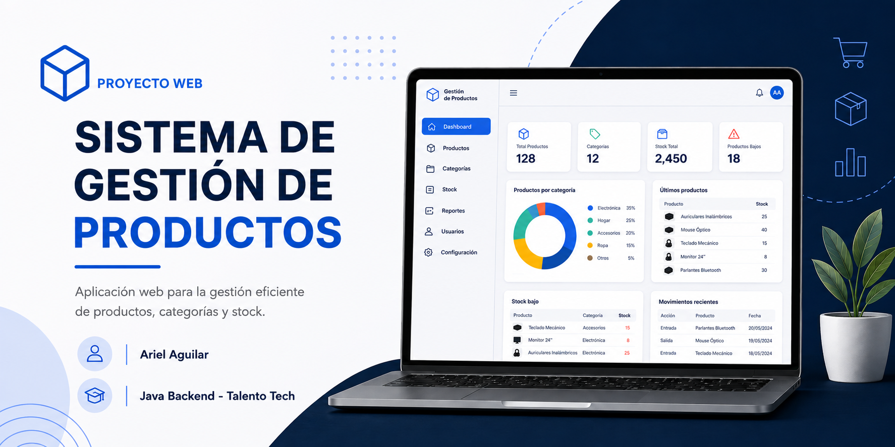
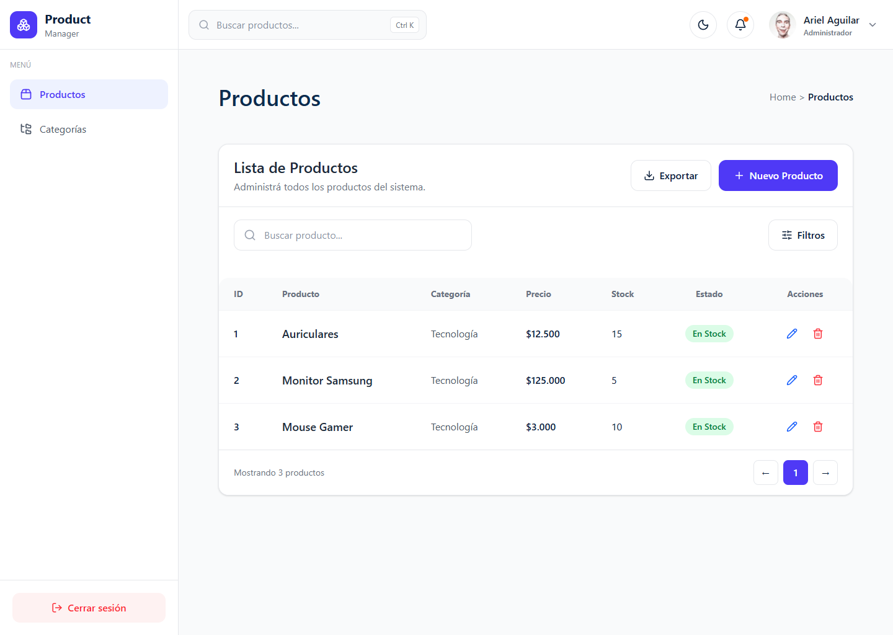
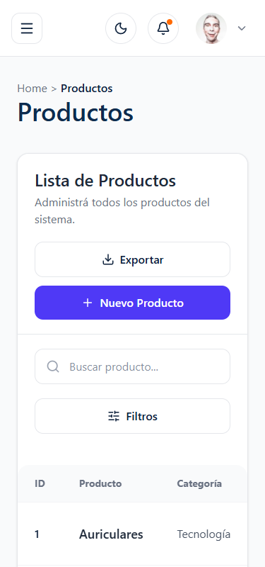
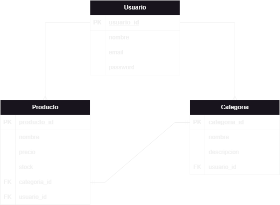

# Sistema de Gestión de Productos

## Tabla de Contenidos

- [Descripción del proyecto](#-descripción)
- [Objetivos](#-objetivos)
- [Funcionalidades](#-funcionalidades)
- [Capturas de pantalla](#-capturas-de-pantalla)
- [Video demostrativo](#-video-demostrativo)
- [Diagramas](#-diagramas)
- [Mejoras futuras](#-mejoras-futuras)
- [Licencia](#-licencia)

## 📋 Descripción

Sistema web desarrollado para ayudar a las empresas a administrar sus productos de forma sencilla e intuitiva. La aplicación permite registrar productos y organizarlos mediante categorías.

## 🎯 Objetivos

- Facilitar el control del inventario de productos.
- Centralizar la información de los productos de la empresa.
- Permitir el registro de productos de manera organizada.

## 🚀 Funcionalidades

### Autenticación de Usuarios
* Registro de usuarios.
* Inicio de sesión seguro.
* Gestión de perfiles.

### Gestión de Productos
* Administración de productos.
* Organización de información de productos.

### Gestión de Categorías
* Creación de categorías personalizadas.
* Clasificación de productos para facilitar el análisis.

## 📸 Capturas de Pantalla

## 🚀 Mejoras futuras

- Visualizar reportes y estadísticas que faciliten el análisis del inventario.

## ▶ Video demostrativo

## 📚 Diagramas

### Diagrama de entidad relacion

## 📄 Licencia

Este proyecto fue desarrollado con fines académicos y de aprendizaje.

© 2026 - Sistema de Gestión de Productos. Todos los derechos reservados.